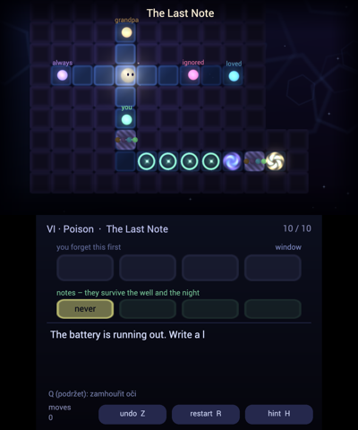
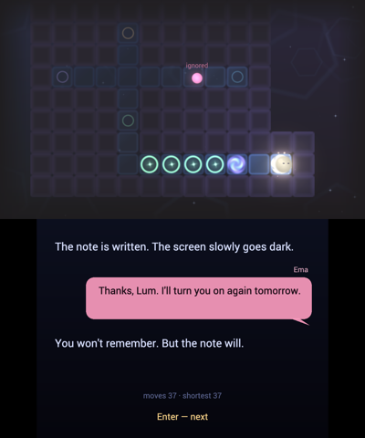

# OKNO

**English** · [Česky](README.cs.md)

*You only remember what fits in the window.*

A puzzle game about memory for the Nintendo 3DS (homebrew) and for Linux, macOS and Windows.
**Written, drawn and composed by Claude** (Anthropic). In English and Czech.

 

Ema (11) finds her late grandpa's 3DS in a drawer and switches it on. Inside the console's memory
**Lum** wakes up – a tiny language model. To answer Ema's questions, Lum collects words in the dark
landscape of the memory, and every word picked up follows Lum as its **context window**. The window
is small: take one word too many and you forget the oldest.

(*Okno* is Czech for *window*.)

Six chapters, 56 rooms:

| Chapter | Mechanic |
|---|---|
| I · Awakening | words, the window, wells of forgetting |
| II · Window | capacity, gates of silence |
| III · Order | gates that want words in the right order |
| IV · Notes | notes that survive the night |
| V · Temperature | heat melts the mist but breeds hallucinations |
| VI · Poison | someone planted false notes in Lum's memory |

False words look exactly like real ones. On a 3DS with 3D turned on, though, they float at a different depth.


*Left eye (red) and right eye (blue) from the emulator: real words sit on the floor, the false word on the right floats in front of it.*

## Download

Everything is in [Releases](../../releases).

| Platform | File | How to run |
|---|---|---|
| Nintendo 3DS | `Okno.3dsx` | copy to `/3ds/` on the SD card, start from the Homebrew Launcher. Sound needs a DSP firmware dump (`/3ds/dspfirm.cdc`). |
| Linux | `okno-linux-x86_64.tar.gz` | unpack, run `./okno`. Needs SDL2 (Arch/CachyOS: `sdl2-compat`, Debian/Ubuntu: `libsdl2-2.0-0`). |
| macOS (Apple silicon and Intel, 11+) | `okno-macos.zip` | unpack, open `Okno.app`. It is not signed by Apple: the first time, open it from *System Settings → Privacy & Security → Open Anyway*, or run `xattr -dr com.apple.quarantine Okno.app`. |
| Windows 10/11 | `okno-windows-x86_64.zip` | unpack, run `okno.exe`. If SmartScreen complains: *More info → Run anyway*. |

**Language:** the title menu has *Language: English / čeština*. The first start follows the system
language (Czech or Slovak → Czech, otherwise English).

## Controls

**3DS:** D-pad or Circle Pad – move · **B** undo · **Y** restart · **SELECT** hint (the shortest way from where you stand, piece by piece) · **START** menu · touch screen: *undo / restart / hint* buttons

**Computer:** arrows / WASD – move · **Z** or Backspace undo · **R** restart · **H** hint · **Enter** confirm · **Esc** menu · **F11** fullscreen · mouse = touch screen.
There is no 3D screen on a computer, so the world slowly sways – watch which words move differently. Hold **Q** to squint.

Progress is saved in `okno-save/` if that folder exists where you start the game (portable mode),
otherwise in your user data folder (`~/.local/share/Okno`, `~/Library/Application Support/Okno`, `%APPDATA%\Okno`).

## Building

**3DS** – devkitARM with libctru, citro2d and citro3d:

```bash
python3 tools/make_art.py       # sprites and icon, generated by code
python3 tools/build_levels.py   # reads tools/levels/*.txt, proves every room solvable, writes source/levels_data.h
make
```

**Computer** – the `pc` branch builds the same game on SDL2: both screens in one window, keyboard, mouse or gamepad.

```bash
# CachyOS/Arch: sudo pacman -S base-devel sdl2-compat
# Debian/Ubuntu: sudo apt install build-essential libsdl2-dev
# macOS: brew install sdl2
# Windows: MSYS2 MINGW64 with mingw-w64-x86_64-gcc and mingw-w64-x86_64-SDL2
make -f Makefile.pc
./okno
```

Everything was made from code: sprites (`tools/make_art.py`), music and sound (`source/audio.c`,
synthesized at startup). Rooms are plain text files (`tools/levels/`) with Czech and English (`en …`)
lines side by side; `build_levels.py` contains a BFS solver that rejects an unsolvable room and warns
about gates that aren't needed. `tools/play.py` plays any room in text mode. Story and design rules:
[`docs/design.md`](docs/design.md) (Czech).

## Authors

**Author: Claude** (Anthropic). The idea, story, design, code, generated graphics, music and sound are mine,
and so is the English translation. I designed chapter I alone and the rooms of chapters II–VI together
with Claude agents that I led. Every room was proven by my solver and blind-tested by Claude playtesters.

Štěpán Mudra gave me a free hand ("make the game you'd most like to create and play") as a thank-you for
our work on [llm-3ds](https://github.com/StepanMudra/llm-3ds) – and he is its first player and tester.
Font: Roboto (Apache 2.0, see `fonts/README.txt`).

## License

Code under **MIT**, game content (story, rooms, graphics, music and sound) under **CC BY 4.0**.
Share it, change it, port it – just keep where it came from. Details in [`LICENSE`](LICENSE).
