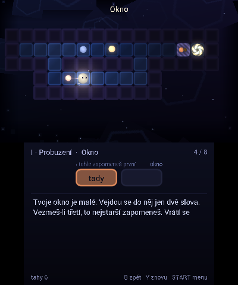
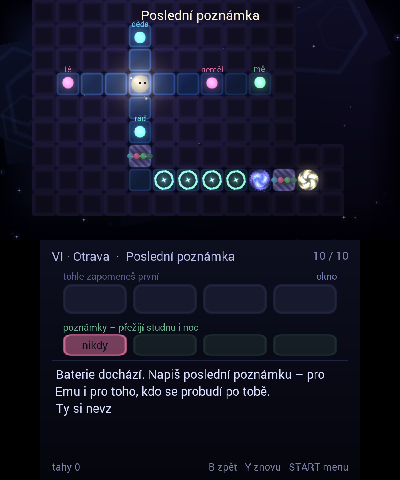
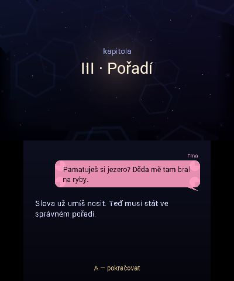
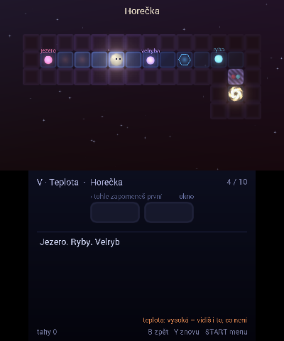

# OKNO

*Pamatuješ si jen to, co se vejde do okna.*

A puzzle game about memory for the Nintendo 3DS (homebrew, Czech).

 

Ema (11) finds her late grandfather's 3DS in a drawer and switches it on. In its memory wakes
**Lum**, a tiny language model. To answer her questions, Lum gathers words in the dark landscape
of the console's memory – and every word he picks up follows him as his **context window**.
The window is small: take one word too many and the oldest one is forgotten.

Six chapters, 58 rooms:

| Chapter | Mechanic |
|---|---|
| I · Probuzení | words, the window, wells of forgetting |
| II · Okno | capacity, gates of silence |
| III · Pořadí | gates that want words in the right order |
| IV · Poznámky | notes that survive the night |
| V · Teplota | heat melts mist but breeds hallucinations |
| VI · Otrava | someone planted false notes into Lum's memory |

Fake words look exactly like true ones. On a 3DS with the 3D slider up, they float at a different depth.

 

## Play

Copy `Okno.3dsx` to `/3ds/` on the SD card and start it from the Homebrew Launcher.
Sound needs the DSP firmware dump (`/3ds/dspfirm.cdc`).

D-pad or Circle Pad – move · **B** undo · **Y** restart · **SELECT** hint (shows the shortest path piece by piece) · **START** menu

## Build

devkitARM with libctru, citro2d and citro3d:

```bash
python3 tools/make_art.py       # sprites + icon, generated from code
python3 tools/build_levels.py   # parses tools/levels/*.txt, proves every room solvable, writes source/levels_data.h
make
```

Everything is made from code: sprites (`tools/make_art.py`), music and sound effects (`source/audio.c`,
synthesised at start-up). Rooms are plain text files (`tools/levels/`); `build_levels.py` contains a
BFS solver that refuses unsolvable rooms and reports gates that are not needed. `tools/play.py` plays
any room in text mode. Story and design rules: [`docs/design.md`](docs/design.md).

## Credits

Idea, code, art, sound and music: Claude (Anthropic). Chapters II–VI were designed by Claude agents
and checked by the solver. Direction, testing and the old 3DS: Štěpán Mudra.
Font: Roboto (Apache 2.0, see `fonts/README.txt`).
