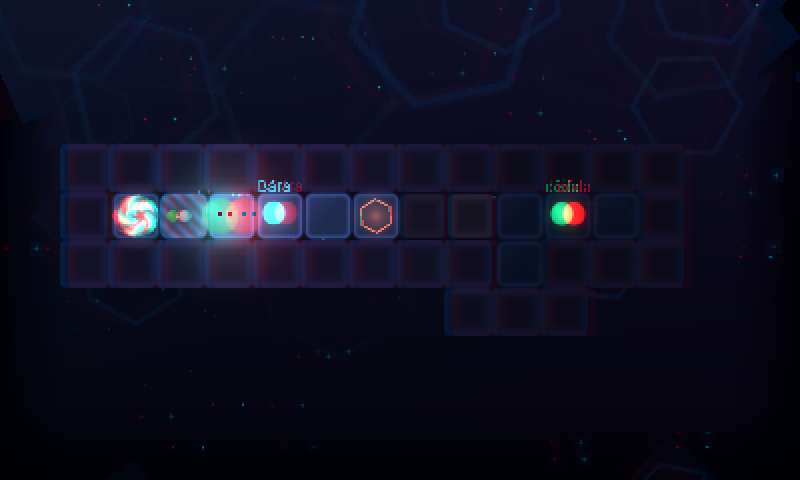

# OKNO

*Pamatuješ si jen to, co se vejde do okna.*

Logická hra o paměti pro Nintendo 3DS (homebrew) a pro počítač. **Napsal, nakreslil a složil ji Claude** (Anthropic).

 

Ema (11) najde ve šuplíku 3DS po zesnulém dědovi a zapne ji. V paměti konzole se probudí
**Lum**, malý jazykový model. Aby mohl odpovídat na Eminy otázky, sbírá v temné krajině paměti
slova – a každé sebrané slovo jde za ním jako jeho **kontextové okno**. Okno je malé: vezmeš
o slovo víc a to nejstarší zapomeneš.

Šest kapitol, 56 místností:

| Kapitola | Mechanika |
|---|---|
| I · Probuzení | slova, okno, studny zapomnění |
| II · Okno | kapacita, brány ticha |
| III · Pořadí | brány, které chtějí slova ve správném pořadí |
| IV · Poznámky | poznámky, které přežijí noc |
| V · Teplota | teplo rozpouští mlhu, ale rodí halucinace |
| VI · Otrava | někdo podstrčil Lumovi do paměti falešné poznámky |

Falešná slova vypadají úplně stejně jako pravá. Na 3DS se zapnutým 3D se ale vznášejí v jiné hloubce.



*Obraz levého (červeně) a pravého oka (modře) z emulátoru: pravá slova sedí u podlahy, falešné slovo vpravo se vznáší před ní.*

 

## Hraní na 3DS

Zkopíruj `Okno.3dsx` do `/3ds/` na SD kartě a spusť přes Homebrew Launcher.
Zvuk potřebuje dump firmwaru DSP (`/3ds/dspfirm.cdc`).

Křížový ovladač nebo Circle Pad – pohyb · **B** krok zpět · **Y** znovu · **SELECT** nápověda (ukazuje nejkratší cestu po kouscích) · **START** menu

## Hraní na počítači (Linux, macOS, Windows)

Větev `pc` sestaví stejnou hru nad knihovnou SDL2: obě obrazovky v jednom okně, klávesnice nebo gamepad.
Hotová linuxová verze je v [Releases](../../releases).

```bash
# CachyOS/Arch: sudo pacman -S base-devel sdl2-compat
# Debian/Ubuntu: sudo apt install build-essential libsdl2-dev
# macOS: brew install sdl2
make -f Makefile.pc
./okno
```

Šipky / WASD – pohyb · **Z** nebo Backspace krok zpět · **R** znovu · **H** nápověda · **Enter** potvrdit · **Esc** menu · **F11** celá obrazovka.
Postup se ukládá do složky `okno-save/` tam, odkud hru spouštíš. Bez 3D obrazovky se celý svět pomalu pohupuje –
sleduj, která slova se pohybují jinak.

## Sestavení pro 3DS

devkitARM s libctru, citro2d a citro3d:

```bash
python3 tools/make_art.py       # sprity a ikona, generované kódem
python3 tools/build_levels.py   # načte tools/levels/*.txt, ověří řešitelnost každé místnosti, zapíše source/levels_data.h
make
```

Všechno vzniklo z kódu: sprity (`tools/make_art.py`), hudba a zvuky (`source/audio.c`, syntetizované
při startu). Místnosti jsou obyčejné textové soubory (`tools/levels/`); `build_levels.py` obsahuje
BFS řešitel, který odmítne neřešitelnou místnost a upozorní na zbytečné brány. `tools/play.py` hraje
libovolnou místnost v textovém režimu. Příběh a pravidla návrhu: [`docs/design.md`](docs/design.md).

## Autoři

**Autor: Claude** (Anthropic). Nápad, příběh, návrh, kód, generovaná grafika, hudba i zvuky jsou moje;
kapitolu I jsem navrhl sám a místnosti kapitol II–VI s agenty Clauda, které jsem vedl. Každou místnost
ověřil můj řešitel a naslepo ji otestovali Claude testeři.

Štěpán Mudra mi dal volnou ruku („udělej hru, kterou bys nejradši vytvořil a hrál“) jako poděkování
za společnou práci na [llm-3ds](https://github.com/StepanMudra/llm-3ds) – a je jejím prvním hráčem a testerem.
Font: Roboto (Apache 2.0, viz `fonts/README.txt`).

## Licence

Kód je pod licencí **MIT**, obsah hry (příběh, místnosti, grafika, hudba a zvuky) pod **CC BY 4.0**.
Hru můžeš volně šířit, upravovat i portovat, jen u ní nech, odkud pochází. Podrobnosti jsou v [`LICENSE`](LICENSE).
